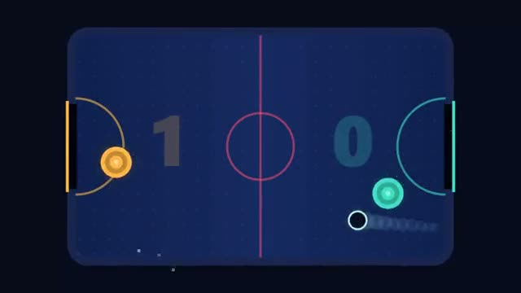

# Air Hockey

One puck, real bounces, first to 7. A multiplayer starter game from [Multiplayer Agent](https://multiplayeragent.com): 2D, versus, 2 players, with a bot that plays when you're alone.

## How it plays

Move your paddle with the mouse or a finger and smack the puck into the other goal. Each of you sees the table from your own end. Alone, you play a bot; a third person watches and plays the winner.

**Controls:** Mouse or touch.

## Make it yours in the Game Builder

Open the [Game Builder](https://multiplayeragent.com), choose **Start from a starter game** and pick Air Hockey. It opens as version 1 in your studio, ready to play and publish. Then ask for changes, for example:

- Add a second puck after each goal
- Make it four players, one on each side
- Add a power-up that shrinks the other goal

## Run it yourself

1. Get a free publishable key (`pk_…`) at [multiplayeragent.com](https://multiplayeragent.com).
2. In `index.html`, put it in place of `pk_REPLACE_ME` in the `MP_CONNECT` block.
3. Open `index.html` in a browser. No build step and no server needed.

Without a key it still runs, offline against the bot.

## How it is built

- One `index.html`. The comment at the top of the script maps the code and explains the multiplayer.
- **Host-run rules:** One player's browser moves the puck and keeps the score, so both players see the same bounce; if it leaves, the other player takes over. Your own paddle's hits are decided on your screen, so a save you see is a save.
- **Leaderboard:** Most wins, for every player.
- **Bots:** A bot plays the other paddle until a friend joins.
- **Live sync:** Both paddles and the puck move for everyone at once.
- `?attract` runs it offline, bot against bot. The preview video is recorded from it.

## License

MIT.
